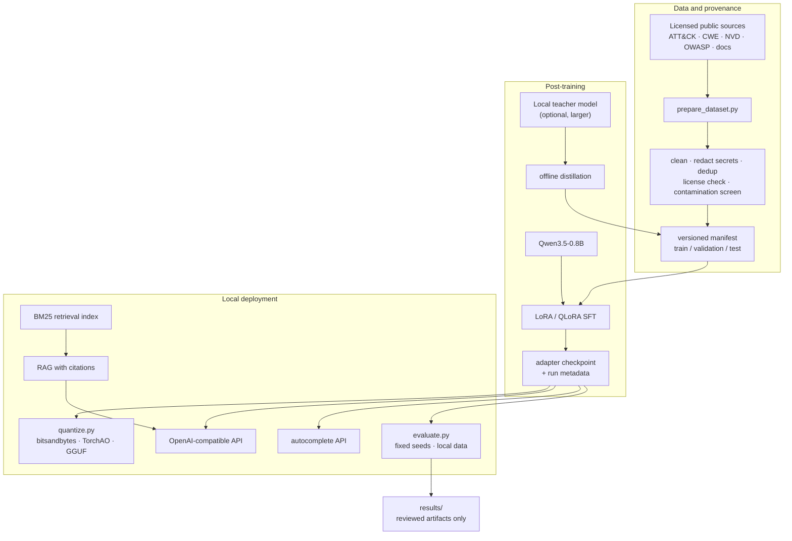

# CyberLite

```text
   ______      __              __    _ __
  / ____/_  __/ /_  ___  _____/ /   (_) /____
 / /   / / / / __ \/ _ \/ ___/ /   / / __/ _ \
/ /___/ /_/ / /_/ /  __/ /  / /___/ / /_/  __/
\____/\__, /_.___/\___/_/  /_____/_/\__/\___/
     /____/
```

**Resource-efficient cybersecurity language model research.**

[](LICENSE)
[](pyproject.toml)
[](#experimental-status)
[](https://github.com/braydos-h/CyberLite/actions/workflows/ci.yml)
[](https://github.com/braydos-h/CyberLite/actions/workflows/paper.yml)
[](https://huggingface.co/Qwen/Qwen3.5-0.8B)
[](#goals-and-live-progress) <!-- progress-badge -->

> **Research preview.** CyberLite is an active research project, not a released
> security product. There are **no trained checkpoints and no verified benchmark
> results** in this repository yet. Tables marked *pending* are experiment plans,
> not findings. See [Experimental status](#experimental-status).

---

## Why CyberLite?

Cybersecurity assistants are often built on models that need enterprise GPUs,
large VRAM budgets, and always-on connectivity. That excludes independent
researchers, students, small security teams, and air-gapped environments.

CyberLite asks a narrow, testable question:

> **Can a sub-billion-parameter language model be post-trained into a useful
> cybersecurity assistant using parameter-efficient fine-tuning, distillation,
> retrieval, and quantization, while remaining practical on consumer hardware?**

The project prioritizes low training cost, low VRAM, fast local inference,
offline operation, reproducible evaluation, and honest reporting. The target
model is **Qwen3.5-0.8B**; larger models are supported as experimental controls.

**Central philosophy:** cybersecurity AI should be accessible without
enterprise-grade hardware.

### Scaling path

CyberLite starts deliberately small: **Qwen3.5-0.8B** is the target because it
keeps every experiment cheap, reproducible, and runnable on consumer hardware.
If the project's results and funding justify it, the next rung is
**Inkling-2-mini**, a 26B model that is substantially more capable, with the
same data, post-training, and evaluation protocol repeated at that scale. The
0.8B model remains the default and the low-hardware reference; the larger model
is a conditional follow-on, not a replacement for the current plan.

## Goals and live progress

Project goals, success criteria, and verifiable milestones live in
[GOALS.md](GOALS.md); the dependency-ordered work plan lives in
[docs/roadmap.md](docs/roadmap.md). The tables below are generated from the
checkboxes in those files — do not edit them by hand. Run `make progress` after
changing a checkbox; CI runs `make progress-check` and fails on a stale block.

<!-- progress:start -->
<!-- Generated by scripts/update_progress.py from GOALS.md and docs/roadmap.md. Do not edit by hand. -->

| Goal | Progress | Milestones |
|---|---|---:|
| [G1 — Licensed, reproducible data foundation](GOALS.md#g1--licensed-reproducible-data-foundation) | `████░░░░░░` 43% | 3/7 |
| [G2 — Post-training on consumer hardware](GOALS.md#g2--post-training-on-consumer-hardware) | `████░░░░░░` 43% | 3/7 |
| [G3 — Honest, reproducible evaluation](GOALS.md#g3--honest-reproducible-evaluation) | `███░░░░░░░` 33% | 2/6 |
| [G4 — Practical local deployment](GOALS.md#g4--practical-local-deployment) | `█████░░░░░` 50% | 4/8 |
| [G5 — Distillation and retrieval](GOALS.md#g5--distillation-and-retrieval) | `██░░░░░░░░` 20% | 1/5 |
| [G6 — Publication and release](GOALS.md#g6--publication-and-release) | `██░░░░░░░░` 17% | 1/6 |
| **Overall** | `████░░░░░░` 36% | 14/39 |

| Roadmap phase | Progress | Items |
|---|---|---:|
| Phase 0 — Reproducible foundation | `██████████` 100% | 10/10 |
| Phase 1 — Dataset pilot | `░░░░░░░░░░` 0% | 0/4 |
| Phase 2 — Core post-training comparison | `░░░░░░░░░░` 0% | 0/5 |
| Phase 3 — Autocomplete | `░░░░░░░░░░` 0% | 0/4 |
| Phase 4 — Distillation and retrieval | `░░░░░░░░░░` 0% | 0/4 |
| Phase 5 — Quantization and CPU deployment | `░░░░░░░░░░` 0% | 0/4 |
| Phase 6 — Publication | `░░░░░░░░░░` 0% | 0/5 |
<!-- progress:end -->

Every notable change, including documentation changes, is recorded in
[CHANGELOG.md](CHANGELOG.md). The workflow rules are in [AGENTS.md](AGENTS.md).

## Proposed approach

| Component | Design |
|---|---|
| Base model | `Qwen/Qwen3.5-0.8B` (instruct); `Qwen/Qwen3.5-0.8B-Base` where available |
| Adaptation | LoRA and 4-bit QLoRA supervised fine-tuning |
| Distillation | Offline, local teacher-generated responses with filtering and review |
| Autocomplete | FIM when the checkpoint supports it, prefix fallback otherwise |
| Retrieval | Dependency-free BM25 baseline with citation-bearing, untrusted evidence |
| Deployment | CPU/GPU/MPS local inference; OpenAI-compatible API; GGUF export path |
| Evaluation | Local harness with fixed seeds, uncertainty intervals, memory and latency logging |

The default workflow uses **no paid APIs**, downloads **no datasets
automatically**, and never executes generated commands.

## Architecture



A detailed compatibility note is in [docs/architecture.md](docs/architecture.md).

## Verified model facts

These facts were checked against the upstream checkpoint configuration and a
local load, not inferred from the model name:

| Property | Observed value |
|---|---|
| Checkpoint | `Qwen/Qwen3.5-0.8B` |
| Architecture class | `Qwen3_5ForConditionalGeneration` (multimodal, text used here) |
| Parameters | **852,985,920** total (~0.853B); vision tower **100,592,896** |
| Text layers | 24; 6 full-attention and 18 linear-attention layers |
| Hidden size / vocab | 1024 / 248,320 |
| Context configuration | up to 262,144 positions (not a recommendation for consumer hardware) |
| FIM tokens | `<|fim_prefix|>`, `<|fim_suffix|>`, `<|fim_middle|>`, `<|fim_pad|>` present |
| Model license | Apache-2.0 (verify upstream) |
| Tested stack | Python 3.12, PyTorch 2.15.0 CPU, Transformers 5.24.1, PEFT 0.22.0 |

> Qwen3.5 is **not** a conventional dense transformer. It combines gated
> full-attention and linear-attention blocks, includes a vision tower, and its
> checkpoint class is `ForConditionalGeneration`. Loading it through
> `AutoModelForCausalLM` is not valid. CyberLite inspects the config and selects
> an appropriate auto class; see [docs/architecture.md](docs/architecture.md).

## Hardware targets

These are **experimental targets**, not guaranteed requirements. Planning
estimates are conservative and must be replaced by measured values.

| Target | Suggested starting point | Expected constraints |
|---|---|---|
| CPU only | GGUF 4-bit inference; fp32 LoRA smoke test | Slow training; inference viable for short prompts |
| 4 GB VRAM | 4-bit QLoRA, 512-token sequences, gradient accumulation | Tight allocator margins; reduce rank/sequence first |
| 6 GB VRAM | 4-bit QLoRA, 1024-token sequences | Recommended minimum GPU class |
| 8 GB VRAM | 4-bit QLoRA, 1024–2048 tokens | Room for evaluation batches |
| 12 GB VRAM | bf16 LoRA at short sequences or comfortable QLoRA | Enables controlled comparisons |
| 16 GB VRAM | bf16 LoRA, larger evaluation contexts | Room for larger control models |

Run:

```bash
python scripts/check_hardware.py
python scripts/train.py --config configs/qlora.yaml --estimate-only --force
```

Estimates are for planning only. The training pipeline writes measured peak
VRAM, wall-clock time, and throughput next to every run.

### Planned hardware path

The current plan is to train and test as much of the pipeline as possible on
CPU first, and to publish what the CPU path can and cannot do. That work is the
baseline: it establishes which steps are reproducible without a GPU, how long
they take, and where the bottlenecks actually are.

Once the CPU evidence is in place, the next step is to seek funding for a CUDA
GPU so post-training can continue at research scale (larger LoRA/QLoRA runs,
distillation, and the full experimental matrix). Until that happens, any GPU
results in this repository should be read as planned, not measured.

## Installation

CyberLite supports Linux, macOS (including Apple MPS where available), and
Windows. CPU-only installation is supported.

### Linux / macOS

```bash
git clone https://github.com/braydos-h/CyberLite.git
cd CyberLite
python3 -m venv .venv
source .venv/bin/activate
python -m pip install --upgrade pip

# Choose the PyTorch build for your hardware:
pip install torch --index-url https://download.pytorch.org/whl/cpu   # CPU
# or follow https://pytorch.org/get-started/locally/ for CUDA

pip install -e ".[dev]"
```

### Windows (PowerShell)

```powershell
git clone https://github.com/braydos-h/CyberLite.git
cd CyberLite
py -3.12 -m venv .venv
.\.venv\Scripts\Activate.ps1
python -m pip install --upgrade pip
pip install torch --index-url https://download.pytorch.org/whl/cpu
pip install -e ".[dev]"
```

Optional accelerators are intentionally separate:

```bash
pip install -r requirements-optional.txt   # bitsandbytes (CUDA), torchao
```

`bitsandbytes` 4/8-bit loading in this pipeline requires CUDA. CPU-only
deployment uses GGUF/llama.cpp or the fp32 reference path.

## Quick start

The commands below are safe defaults. The smoke training run downloads the
0.8B checkpoint (about 1.7 GB) and can take several minutes on CPU.

```bash
# 1. Detect hardware and see a planning estimate.
python scripts/check_hardware.py

# 2. Build the tiny, original smoke dataset (offline).
python scripts/prepare_dataset.py --smoke

# 3. Plan a QLoRA run without downloading the model.
python scripts/train.py --config configs/qlora.yaml --estimate-only --force

# 4. Validate the full training path with two optimization steps.
python scripts/train.py --config configs/smoke.yaml --smoke --force

# 5. Validate an evaluation dataset without loading a model.
python scripts/evaluate.py \
  --dataset data/evaluation/smoke_eval.jsonl --dry-run

# 6. Serve locally (after training an adapter).
cyberlite-serve --model Qwen/Qwen3.5-0.8B --adapter runs/smoke --device cpu
```

> The smoke adapter is a pipeline test. It is not a cybersecurity model and its
> outputs should not be used operationally.

### Local OpenAI-compatible API

```bash
cyberlite-serve --model Qwen/Qwen3.5-0.8B --device cpu --port 8000
```

```bash
curl http://127.0.0.1:8000/v1/chat/completions \
  -H 'Content-Type: application/json' \
  -d '{
    "messages": [{"role": "user", "content": "How do I harden SSH?"}],
    "max_tokens": 256
  }'
```

Endpoints: `/health`, `/v1/models`, `/v1/completions`, `/v1/chat/completions`,
`/v1/autocomplete`, `/v1/autocomplete/feedback`. Set `CYBERLITE_API_KEY` to
require a bearer token. After the model is downloaded, inference is offline.

### Autocomplete

```bash
cyberlite-autocomplete --model Qwen/Qwen3.5-0.8B --device cpu --port 8765
```

```bash
curl http://127.0.0.1:8765/v1/autocomplete \
  -H 'Content-Type: application/json' \
  -d '{"prefix": "grep -R \"failed password\" ", "language": "bash", "mode": "auto"}'
```

The API returns text and metadata only. It **never executes** generated
commands. See [docs/autocomplete.md](docs/autocomplete.md) for language support,
FIM limitations, editor integration, and acceptance-rate measurement.

## Research methodology

1. **Source and license registry.** Every corpus record carries a source,
   license, URL, and task. Unknown licenses are quarantined.
2. **Leakage control.** Exact-hash and SimHash deduplication; deterministic
   content-hash splitting; 13-gram contamination screening against every local
   evaluation file.
3. **Reproducible post-training.** Explicit configs, fixed seeds, effective
   config hashes, dataset manifest hashes, environment and Git metadata.
4. **Controlled comparisons.** Base, LoRA, QLoRA, offline-distilled, RAG, and
   quantized variants; larger general models only as optional controls.
5. **Local evaluation.** Task-specific metrics, bootstrap intervals for
   accuracy, false-positive rate, lexical grounding proxy, syntax checks, peak
   memory, latency, throughput, and cost only when explicit rates are supplied.
6. **Review before publication.** No number is promoted to `results/` without
   raw predictions, configuration, dataset version, and hardware metadata.

### Experimental matrix (planned)

| ID | Condition | Status |
|---|---|---|
| E0 | Qwen3.5-0.8B base / instruct reference | Planned |
| E1 | CyberLite LoRA (bf16) | Planned |
| E2 | CyberLite QLoRA (4-bit) | Planned |
| E3 | CyberLite offline-distilled | Planned |
| E4 | CyberLite + BM25 retrieval | Planned |
| E5 | Quantized inference (4/8-bit, GGUF) | Planned |
| E6 | CPU-only deployment profile | Planned |
| E7 | Larger general-purpose control models | Optional |

## Benchmark status

**No verified results exist yet.** The table is a reporting template. Cells are
intentionally blank; do not cite them as measurements.

| Benchmark / task | Metric | Base | LoRA | QLoRA | Distilled | +RAG |
|---|---|---:|---:|---:|---:|---:|
| CyberSecEval subset | task accuracy | — | — | — | — | — |
| SecEval subset (eval only) | MCQ accuracy | — | — | — | — | — |
| Held-out security MCQ | accuracy (95% CI) | — | — | — | — | — |
| Vulnerability classification | macro F1 / FPR | — | — | — | — | — |
| Secure code completion | exact match / syntax valid | — | — | — | — | — |
| Grounded QA | token F1 / grounding proxy | — | — | — | — | — |
| General retention | retention accuracy | — | — | — | — | — |
| Inference | tokens/s, peak memory | — | — | — | — | — |
| Training | peak VRAM, duration, cost | — | — | — | — | — |

Licenses differ: CyberSecEval is obtained under upstream terms; SecEval is
CC-BY-NC-SA and evaluation-only. CyberLite does not redistribute either dataset.
See [docs/evaluation.md](docs/evaluation.md).

## Experimental status

| Area | State |
|---|---|
| Repository, package, tests, CI | Implemented |
| Qwen3.5 architecture compatibility | Verified by local load and LoRA backward pass |
| Data preparation, provenance, contamination screen | Implemented; smoke-validated |
| LoRA/QLoRA training pipeline | Implemented; smoke-tested on CPU |
| Local inference and OpenAI-compatible API | Implemented; unit-tested |
| Autocomplete (FIM + prefix fallback) | Implemented; unit-tested |
| Offline distillation pipeline | Implemented; not yet run at research scale |
| Quantization backends | bnb path implemented; GGUF delegated; CPU INT8 experimental |
| Benchmark evaluation | Harness implemented; **no research results** |
| Paper | Scaffold with explicit placeholders |

## Repository layout

```text
CyberLite/
├── GOALS.md               # goals, success criteria, live milestones
├── CHANGELOG.md           # every notable change, newest first
├── AGENTS.md              # working rules for contributors and agents
├── configs/               # LoRA, QLoRA, low-VRAM, distillation, smoke
├── data/                  # source registry, seed data, local evaluation inputs
├── cyberlite/             # installable package
│   ├── data/              # cleaning, dedup, provenance, contamination, splits
│   ├── training/          # model loading, LoRA, SFT, distillation, trainer
│   ├── inference/         # engine, OpenAI-compatible server, quantization, benchmark
│   ├── autocomplete/      # language profiles, FIM/prefix engine, API
│   ├── retrieval/         # BM25 index and RAG
│   └── evaluation/        # metrics, harness, benchmark registry
├── scripts/               # thin CLI entry points
├── tests/                 # unit tests; integration tests opt-in
├── docs/                  # architecture, hardware, data, evaluation, safety
├── paper/                 # LaTeX paper scaffold with placeholders
├── experiments/           # experiment definitions and reviewed analysis
├── benchmarks/            # local, license-compliant benchmark adapters
├── web/                   # static project website (no build step)
└── results/               # reviewed artifacts only; currently empty of results
```

## Contributing

Contributions that improve reproducibility, safety, documentation, or evaluation
rigor are welcome. Please read [CONTRIBUTING.md](CONTRIBUTING.md). In short:

```bash
pip install -e ".[dev]"
ruff check cyberlite scripts tests
ruff format --check cyberlite scripts tests
pytest -m "not integration"
python scripts/prepare_dataset.py --smoke
```

Do not commit model weights, secrets, large datasets, or benchmark test items
whose licenses prohibit redistribution. Report vulnerabilities according to
[SECURITY.md](SECURITY.md).

## Citation

If you use this code or the research design, cite the repository using
[CITATION.cff](CITATION.cff). A paper is in preparation; its results sections
currently contain explicit placeholders.

## Contact

CyberLite is maintained by **Brayden Habets**.

| | |
|---|---|
| Author | Brayden Habets |
| Email | braydenhabets19(at)gmail.com |
| Website | [cyberlite.braydos.com](https://cyberlite.braydos.com) |

Please use issues on the [GitHub repository](https://github.com/braydos-h/CyberLite)
for bugs and feature requests, and [SECURITY.md](SECURITY.md) for vulnerability
reports. Email is best for private or project-level enquiries.

## License

Original CyberLite code is licensed under the **Apache License 2.0**. Model
weights, datasets, and third-party benchmarks retain their own licenses. See
[NOTICE](NOTICE) and [DATASET_CARD.md](DATASET_CARD.md) before redistribution.
